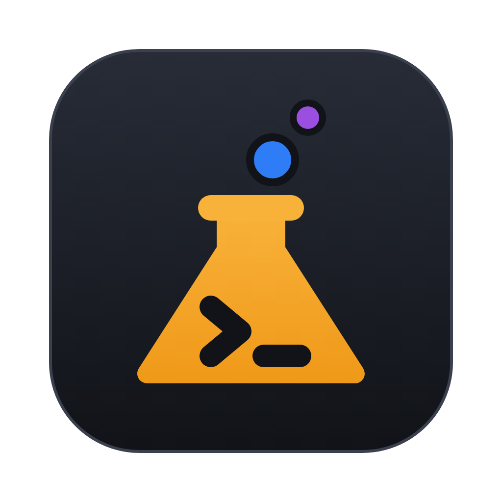
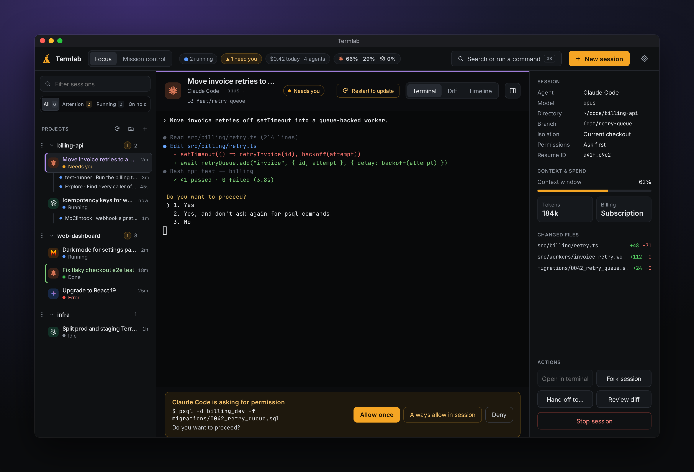
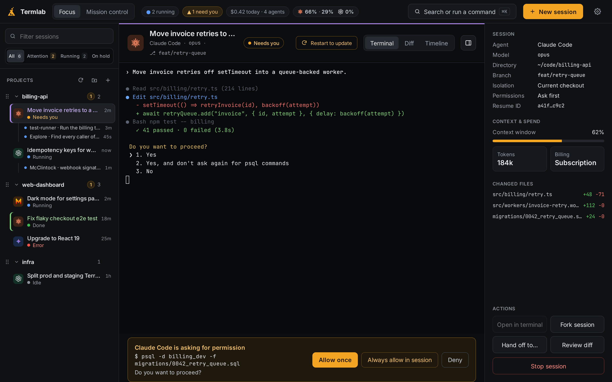
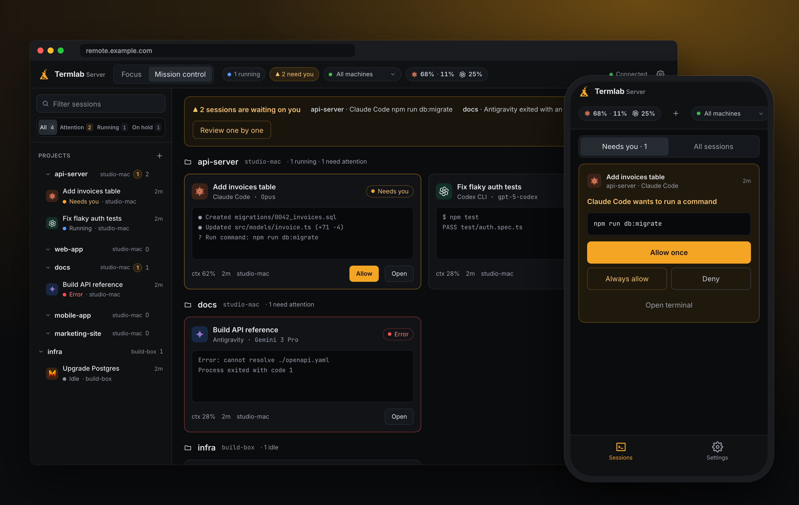

<div align="center">



# Termlab

**A desktop session manager for AI coding agents: run Claude Code, Codex CLI, Mistral Vibe and Antigravity CLI side by side, and see at a glance which one needs you.**

A GUI for running several Claude Code and Codex sessions in parallel, for macOS, Linux and
Windows. With the self-hosted [Termlab Server](#termlab-server-remote-access-from-your-phone), you can
answer agent permission prompts and type into their terminals from your phone.

[](https://github.com/pascallieverse/termlab/releases/latest)
[](https://github.com/pascallieverse/termlab/actions/workflows/ci.yml)


[Download](#download) · [Features](#features) · [Termlab Server](#termlab-server-remote-access-from-your-phone) · [How it works](#how-it-works) · [FAQ](#faq) · [Development](#development)

<br>



<sub>Sample data. The screenshots are retaken automatically for every release.</sub>

</div>

## Why Termlab

Running several AI coding agents at once in plain terminal tabs gets messy fast: one is waiting
for an approval, another finished ten minutes ago, a third ran out of context, and you only
find out by clicking through every tab.

Termlab runs each agent's **real CLI** in a pseudo-terminal, with the agent's own login and
subscription, and adds the management layer around it. Sessions are grouped by project,
show their live status, and ask for your attention only when they need it. They keep running
in a background service when you close the window.

Supported agents:

| Agent | Command | Resume | Fork | Live status via hooks |
|---|---|:-:|:-:|:-:|
| [Claude Code](https://docs.anthropic.com/en/docs/claude-code) | `claude` | ✓ | ✓ | ✓ |
| [Codex CLI](https://github.com/openai/codex) | `codex` | ✓ | ✓ | ✓ |
| Mistral Vibe | `vibe` | | | |
| Antigravity CLI | `agy` | ✓ | | |

Agents without hooks get their status from the terminal screen instead.

## Features

- **One window for every agent session.** Sessions are grouped by project folder, each with
  its full interactive terminal. Drag projects to reorder them.
- **Status at a glance.** Every session shows *Needs you*, *Running*, *Idle*, *Done* or
  *Error*, with badges per project and filters for All, Attention, Running and On hold.
- **Approvals without hunting.** When an agent asks permission to run a command or edit a
  file, Termlab shows the request with **Allow once**, **Always allow** and **Deny**, in the
  session and in Mission control.
- **Mission control.** A grid of every session with its last terminal lines, grouped by
  folder, agent or status, plus a "waiting on you" queue to review one by one.
- **Inspector.** Agent, model, branch, permission mode, context window use, tokens, cost
  (for API-key billing), changed files, a diff view and a timeline of prompts and tool calls.
- **Subagents.** See an agent's running subagents (test runners, explorers, reviewers) under
  its session.
- **Remote access, on your own server.** Watch sessions, answer approvals and type into
  terminals from a browser or your phone, with push notifications, webhooks and screen
  sharing. Nothing goes through a third party. See
  [Termlab Server](#termlab-server-remote-access-from-your-phone).
- **Plan usage.** Your Claude and Codex plan limits in the header, so you know how much of the
  week is left.
- **Resume, fork and hand off.** Pick up an earlier session, branch it, or hand the task to a
  different agent with a summary of what was done so far.
- **Import existing sessions.** Load sessions you started outside Termlab, from one project or
  from anywhere on the machine.
- **Plain terminals** next to the agents: open your own shell in a project from New session
  or the command palette.
- **Drop files on a terminal** to type their paths, as in Terminal.app and iTerm.
- **Split view.** Up to six sessions next to and above each other. Drag a session from the
  sidebar onto the terminal: an edge opens it there, the middle replaces what's shown. Drag a
  pane by its header to move it, and the lines between panes to resize. Each pane keeps its
  own Terminal, Diff or Timeline tab, and the arrangement is remembered.
- **Notifications** when a session needs you, finishes or fails.
- **On hold.** Park a session so it stops counting towards attention badges and notifications,
  without stopping its process.
- **Labels.** Make your own coloured labels ("Bug", "Client work", "Waiting on review") and
  put them on sessions: right-click a session and choose **Labels…**. They show in the
  sidebar, the session's header and Mission control, and the sidebar filters and searches by
  them.
- **Sessions survive the app.** A per-user background service owns the terminals. Close the
  window, reopen it, and the scrollback is replayed.
- **⌘K command palette** and keyboard shortcuts for everything, all rebindable.
- **12 themes**, including Tokyo Night, Catppuccin Mocha, Dracula, Gruvbox, Nord and One Dark,
  with adjustable terminal font, line spacing and cursor.
- **Per-project `.env` editor**: right-click a project and choose **Edit .env…**.
- **Updates itself** from GitHub releases, after you confirm.

<details>
<summary><b>More screenshots</b></summary>
<br>

<br><br>

</details>

## Download

Get the latest version from the [**Releases page**](https://github.com/pascallieverse/termlab/releases/latest).

| Platform | Package |
|---|---|
| macOS, Apple Silicon (macOS 12 or later) | `.dmg` |
| Linux, x86-64 | `.deb`, `.rpm` |
| Windows, x86-64 | `-setup.exe` installer |

Intel Macs are not supported. Only the macOS build has been run on a real machine so far: the
Linux and Windows builds compile and are packaged, but are untested.

You also need at least one of the agents installed and signed in (`claude`, `codex`, `vibe`
or `agy`). Termlab finds them on your `PATH` and uses their own login: it never asks for your
API keys or subscription credentials.

> [!NOTE]
> If a macOS build isn't notarized yet, macOS blocks it the first time. Open
> **System Settings → Privacy & Security** and choose **Open Anyway**. On Windows, SmartScreen
> may warn before the installer runs.

## Termlab Server: remote access from your phone



`termlab-server` is a small server you run yourself, on a VPS or a machine at home behind
HTTPS. Your Termlab computers connect to it, and you open it in any browser or add it to your
phone's home screen. Away from your desk you can:

- **Answer approvals.** When Claude Code or Codex asks permission to run a command or edit a
  file, you get a push notification, and **Allow once**, **Always allow** or **Deny** is one
  tap.
- **Use the terminal.** Open any session's live terminal, read what the agent did, type a
  reply, stop it or put it on hold.
- **Start new sessions** in any project on any linked computer: pick the agent, model and
  permission mode (*Ask first*, *Auto-edit* or *Full auto*).
- **See every computer at once.** Sessions from all your machines in one Focus view and one
  Mission control, filtered per machine, with your Claude and Codex plan usage.
- **Share the screen.** See a computer's desktop and use its mouse and keyboard (macOS,
  Windows, Linux with X11 or Wayland). H.264 or HEVC, up to 4K at 60 fps, and on a phone it
  works as a trackpad. It's off until you switch it on in Termlab on that computer.
- **Send webhooks** to Slack, CI or your own scripts when a session needs you,
  finishes, fails or starts. Each delivery is signed with HMAC-SHA256, and can carry a bearer
  token, basic auth or your own headers.
- **Start sessions from incoming webhooks.** Give GitHub, a CI pipeline or a form a secret
  URL, and each call starts an agent session with a message built from the request
  (`{{body.issue.title}}`, `{{query.x}}`). It can also pick the project and labels.

**Private by design.** The server has one owner account, with a password and an
authenticator app (TOTP). Each computer opens an outgoing websocket to it, so nothing has
to be reachable at home. Terminal output passes through without being stored, and an audit
log records every sign-in, approval, message and session start. There is no shared,
hosted service: the only server that can reach your computers is yours.

**Small.** One static binary (x86-64 or arm64 Linux) or a Docker image, with one SQLite file.
256 MB of RAM is plenty. Put Caddy or nginx in front of it for HTTPS:

```sh
docker run -d --name termlab-server --restart unless-stopped \
  -p 127.0.0.1:8484:8484 -v termlab-data:/data \
  -e TERMLAB_PUBLIC_URL=https://remote.example.com \
  ghcr.io/pascallieverse/termlab-server:latest
```

Then open the address, create the owner account with the setup token from
`docker logs termlab-server`, and link each computer in Termlab under **Settings › Remote
access** with a pairing code.

- [**Self-hosting guide**](docs/self-hosting.md): install (Docker or systemd), HTTPS with
  Caddy or nginx, pairing, screen sharing, settings, security, backups and upgrades.
- [**API and protocol**](docs/server-protocol.md): the HTTP API, webhook payloads and
  signatures, and the websocket protocol, for scripts and integrations.

## How it works

```
 Termlab.app (Tauri + React)  ⇄  termlabd (per-user daemon, owns the ptys)  ⇄  agent CLIs
        unix socket: termlabd.sock          ↑ hook.sock          ↓ outgoing websocket (optional)
                                            termlab-hook         termlab-server  ⇄  browser / phone
                                            ↑ run by Claude Code hooks / Codex notify
```

- `crates/termlab-core`: everything except UI.
  - Agent adapters, pty sessions with a headless screen model (`vt100`), and scrollback.
  - SQLite with migrations, status detection (hooks and screen heuristics), approvals.
  - Discovery, git, transcripts, and the app⇄daemon protocol (`ipc`).
- `crates/termlabd`: the daemon. Sessions keep running when the app closes. The app re-attaches
  and replays scrollback. The daemon exits after 10 idle minutes with no sessions.
- `crates/termlab-hook`: a tiny forwarder that agents' hooks run. It never prints and always
  exits 0.
- `crates/termlab-server`: the self-hosted server (axum, SQLite), with its web UI from
  `apps/server-web` (React) built in. termlabd keeps the link to it up when one is set.
- `crates/termlab-screen`: the screen-sharing helper that captures, encodes and takes input.
- `apps/desktop`: the Tauri 2 app (`src-tauri/`) and React/Vite frontend (`src/`).
- `design/`: the visual spec. `docs/agent-notes.md`: every agent flag and path as verified.

Everything stays on your machine. Data lives in `~/Library/Application Support/dev.termlab.Termlab/`
(Linux: `~/.local/share/termlab/`, Windows: `%APPDATA%\termlab\Termlab\data\`):
- `termlab.sqlite`
- `scrollback/<session>.log`
- the sockets (on Windows these are named pipes instead: `\\.\pipe\termlab-…`)
- `termlabd.log`

## FAQ

**Is Termlab a replacement for Claude Code or Codex?**
No. It runs the official CLIs unchanged, in a real terminal, and adds session management
around them. Everything the CLI can do still works.

**How do I run several Claude Code sessions in parallel?**
Start them from **New session** (⌘N) in Termlab, in the same project or in different ones.
Each runs in its own terminal. The sidebar and Mission control show which one is running,
waiting for an approval or done, and split view shows up to six side by side.

**Can I approve Claude Code or Codex permission prompts from my phone?**
Yes, with [Termlab Server](#termlab-server-remote-access-from-your-phone) on your own server.
Your phone gets a push notification when a session needs you, and you can allow or deny the
request, or open the terminal and type a reply.

**Does remote access go through a cloud service?**
No. You run `termlab-server` yourself, and your computers connect only to it. There is no
account with us and nothing in between.

**Does it use my Claude or ChatGPT subscription, or an API key?**
Whatever the agent itself is signed in with. Termlab shows which one each session uses, and
the cost per day for sessions billed through an API key.

**What happens to running agents when I close the window or the app updates?**
They keep running in the background service (`termlabd`). Reopening Termlab reattaches to them
and replays their output.

**Can I manage sessions I started in a normal terminal?**
Yes: **Load existing sessions…** imports them, and running Claude Code background sessions
show up so you can attach to them.

**Does Termlab send my code or prompts anywhere?**
No. Your code and prompts go only to the agent CLIs on your machine (which talk to their own
providers as usual). Termlab itself connects to GitHub to check for updates; it reaches
YouTube Music only if you open its built-in music player, and nekos.best only if you turn on
the optional anime art in Settings.

## Development

```sh
cd apps/desktop
npm install
npm run tauri dev     # builds termlabd + termlab-hook, then runs Vite and the app
```

`npm run dev` alone serves the UI in a browser with a mocked daemon (sample data), for layout
work.

The app starts `termlabd` from next to its own executable. A daemon from an older build is
replaced automatically when it has no running sessions.

### Checks

```sh
cargo fmt --check
cargo clippy --all-targets -- -D warnings
cargo test --workspace            # fake agent only: no real agent, no network
(cd apps/desktop && npm run typecheck)
```

To check against real agents (uses their logins and a little quota):

```sh
cargo build -p termlab-hook
cargo run -p termlab-core --example live_probe -- claude haiku   # or: codex | vibe
```

### Build the app

```sh
cd apps/desktop && npm run bundle
```

This builds `termlabd` and `termlab-hook` in release mode for the computer it runs on and
packages them next to the app (`scripts/sidecars.mjs`, `src-tauri/release.conf.json`).
Plain `npm run tauri build` only compiles the app: it leaves out the two helper programs
and makes no package.

Releases are built by GitHub Actions when a version tag is pushed: see
[`docs/releasing.md`](docs/releasing.md).

### Screenshots

The images in this README come from the UI running on its mocked daemon
(`apps/desktop/src/devMock.ts`), so they only ever show sample data. When a release is
published, [`.github/workflows/screenshots.yml`](.github/workflows/screenshots.yml) retakes
them, commits them to `docs/screenshots/` and attaches them to the release. To retake them
locally:

```sh
cd apps/desktop
npx playwright install chromium    # once; or skip it and use Chrome: PW_CHANNEL=chrome
npm run screenshots
```

To change what they show, edit the sample data in `devMock.ts` or the steps in
`scripts/screenshots.mjs`.

## License

Termlab is source-available under the [Functional Source License, Version 1.1, ALv2 Future
License](LICENSE.md) (FSL-1.1-ALv2). You may use, modify and redistribute it for any purpose
except offering a competing product or service. Each release becomes available under the
Apache License 2.0 two years after it was published.

`termlab-server` (in `crates/termlab-server`) is part of Termlab and under the same license.
